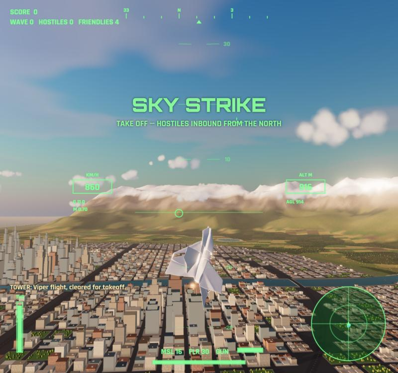
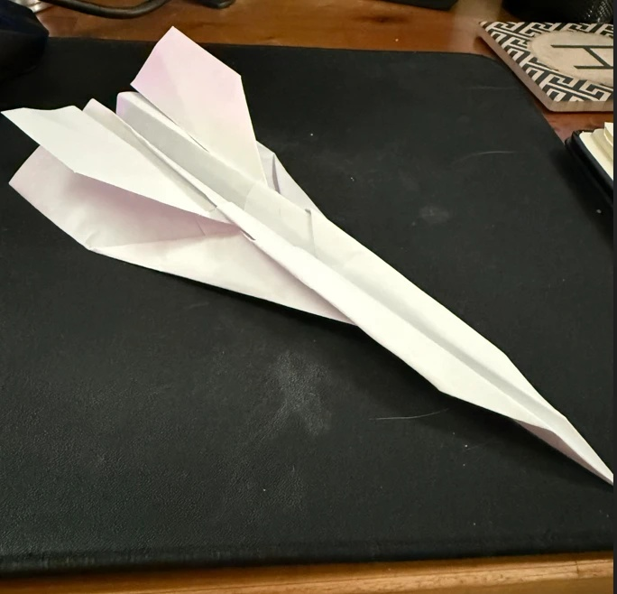
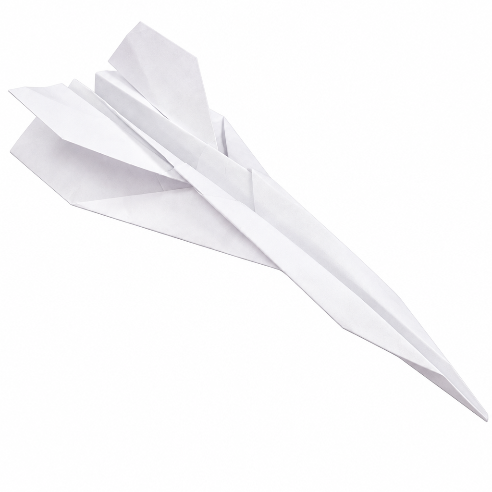
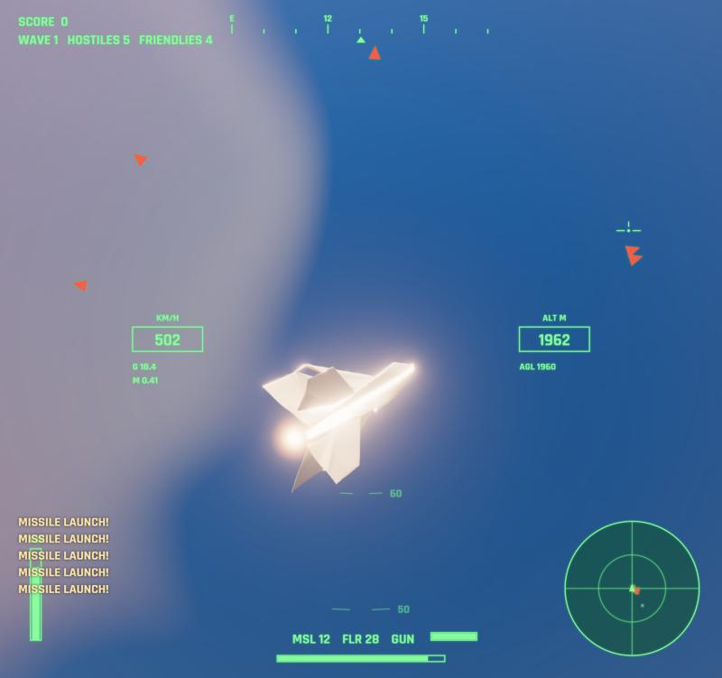
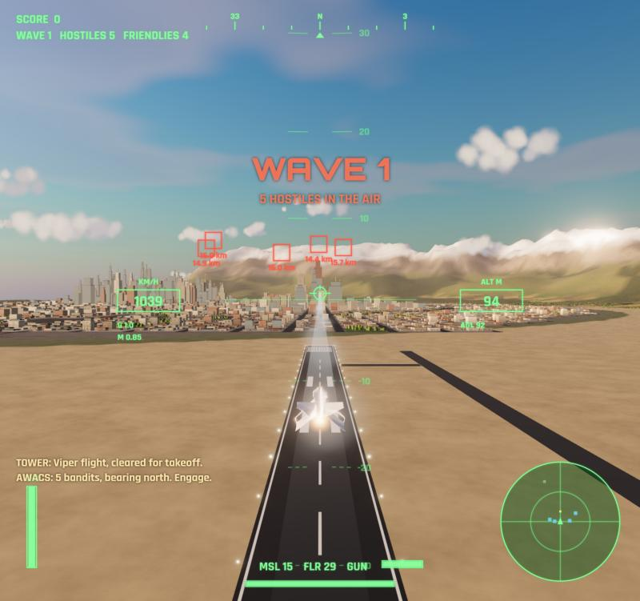
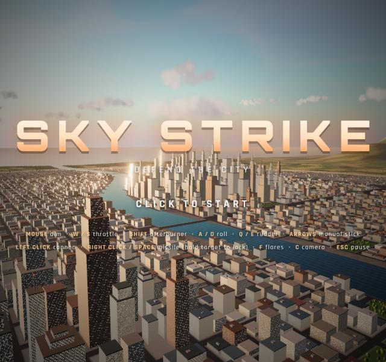
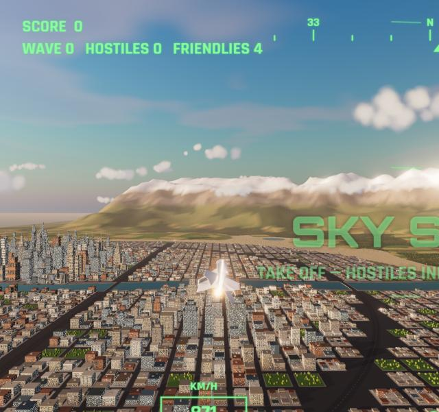

# SKY STRIKE: turn a paper airplane into a video game

I folded a paper airplane, took a photo of it, and Claude Opus 5.5 + Higgsfield turned it into a playable 3D jet combat game in the browser.



**Try Higgsfield (3-day free MCP trial):** [higgsfield.ai](https://higgsfield.ai/s/higgsfield-ai-x-claude-opus-5-5-ig-chase-h-ai-sWbeSq)

> This project is a paid collaboration with Higgsfield.

---

## How it works

```
fold a paper plane → snap a photo → Claude Code + Higgsfield MCP → playable game
                                          │
            Higgsfield makes the assets:  ├─ clean image of your plane → 3D model
                                          ├─ enemy fighter jet → 3D model
                                          └─ sound effects + combat music
            Claude writes the game:       three.js city, flight, combat, HUD
```

| Your photo | Higgsfield clean shot | In the game |
|---|---|---|
|  |  |  |

## Make your own

1. **Fold a paper airplane and take a photo of it.**
2. **Add the Higgsfield connector to Claude Code:**
   ```bash
   claude mcp add --transport http higgsfield https://mcp.higgsfield.ai/mcp
   ```
   Then run `/mcp` inside Claude Code and sign in to Higgsfield.
3. **Make a new folder, put your photo in it as `paper-plane.jpg`, and open Claude Code there.**
4. **Paste the prompt below** (it's also in [`PROMPT.md`](PROMPT.md)) and let it build.

Results vary from run to run. If something looks off, tell Claude what to fix, just like you would with any build.

## The prompt

```text
Build "SKY STRIKE": a 3D jet combat game that runs in the browser, starring the paper airplane in the photo I attached (paper-plane.jpg). Use three.js + Vite, no game engine. This is going to be shown in a video, so it has to be a visual spectacle and look as real as possible. Take the time to get the look right.

1. Assets from Higgsfield (use the Higgsfield MCP)
- Upload my photo to Higgsfield (media_upload, PUT the file to the upload URL, then media_confirm).
- Player plane: first use Higgsfield image generation (gpt_image_2_5) with my photo as the reference to make a clean shot of the exact same paper plane, isolated on a plain white background, three-quarter top view. Then turn that image into a textured 3D model with meshy_v7_image_to_3d (texture + PBR on, symmetry on, ~20k polys). Save it to public/models/player.glb.
- Enemies: generate an image of a realistic modern fighter jet (dark gray, generic, no real-world insignia or text) on a white background, turn it into a 3D model the same way, and save it to public/models/enemy.glb.
- Sound: use the game audio models: mirelo_text_to_audio for 5 sound effects (looping jet engine, afterburner roar, cannon burst, missile launch, big explosion) and sonilo_music for one 30-second intense combat music track. Save them to public/audio/ and mix them so the music sits under the effects.
- Generated GLBs come in unknown orientations: auto-detect the nose (the narrow end of the longest axis), rotate it to face forward, center it, and scale it to a real jet length. If any generation fails, build a low-poly folded-paper plane in code so the game still runs.

2. World (make it look real)
- A huge realistic city at golden hour: thousands of buildings (one InstancedMesh with a procedural window shader: glass and concrete facades, some lit windows, and anti-aliased with fwidth so distant windows don't shimmer), downtown skyscrapers with setbacks and blinking red beacons, a street grid drawn into a canvas ground texture, highways with moving car lights, a river with reflective water, parks with trees, and an airbase with a runway where I spawn on the ground and take off.
- The sea on one side, forests and farmland patchwork outside the city, snow-capped mountains in the distance, a physically based sky (three's Sky) with a low sun, fog/haze, and layered billboard clouds I can fly through.
- Cinematic post-processing: bloom (high threshold so only the sun, explosions and tracers glow), ACES tone mapping, long soft shadows from the low sun that follow the player. Clamp the Sky shader's brightness and use a separate additive sun sprite for the glow, otherwise bloom washes out the screen. Don't use three's Lensflare together with MSAA.
- Buildings are solid: crashing into a tower kills you, and bullets/missiles hit them.
- It must hold 60fps: instancing, no per-frame allocations in hot loops.

3. Flying
- Mouse-aim flight (like War Thunder): the mouse moves an aim point, the plane banks and turns toward it. W/S throttle, Shift afterburner, A/D roll, Q/E rudder, arrows manual stick, C switches chase/cockpit camera. Pointer lock, Esc pauses.
- Takeoff roll from the runway, stall at low speed, crash on ground contact. Close chase cam slightly above the plane so my paper plane is big and clearly visible on screen (make it about 20 m long), with speed-based FOV and camera shake on hits and near explosions. Keep the afterburner glow subtle so it never washes out the plane.

4. Combat
- Left click: cannon with glowing tracers and overheat. Right click or Space: missile that locks after I hold the target for 1 second (lock tone), with a continuous white smoke ribbon trail. F: flares that decoy enemy missiles.
- Enemies come in waves that grow each wave. They dogfight, break, fire missiles at me, and pop flares. 4 AI wingmen with callsigns fly formation and engage. Anti-aircraft sites in the city fire tracer streams and black flak bursts.

5. HUD (canvas overlay sized with CSS width:100vw/height:100vh so it stays crisp on high-DPI screens)
- Green fighter-jet HUD: speed and altitude boxes, pitch ladder, heading tape, throttle bar, G-force, radar minimap, red target boxes with range, lock diamond, gun lead pip, off-screen enemy arrows, missile/flare count, gun heat, health.
- Alerts: MISSILE WARNING, PULL UP, STALL. Score, wave and hostile counter. "SPLASH ONE" on each kill, radio chatter lines.

6. Effects
- Ribbon contrails and wingtip vapor under high G (fade them out near the camera), afterburner glow and flame, muzzle flash, missile smoke, huge fireball explosions with a shockwave ring, sparks and rising smoke, burning wrecks trailing smoke as they fall.

7. Game loop
- Cinematic title screen (slow orbit over the skyline, big "SKY STRIKE" logo, "click to start", controls list). Esc to pause, death screen with score, click to fly again.
- Add a ?demo URL mode where an AI flies my plane so I can record B-roll without playing.

8. Finish
- Run the dev server, play-test it (use the ?demo mode to check combat), fix every console error, and give me the URL.
```

## Play my build

This repo includes my finished game, with the 3D models and audio Higgsfield generated for my plane.

```bash
git clone https://github.com/cth9191/sky-strike.git
cd sky-strike
npm install
npm run dev
```

Open http://127.0.0.1:5173 to play, or http://127.0.0.1:5173/?demo to watch the autopilot fly.

**Controls:** mouse aim · W/S throttle · Shift afterburner · A/D roll · Q/E rudder · arrows manual stick · left click cannon · right click / Space missile (hold on a target 1s to lock) · F flares · C camera · Esc pause

## Screenshots

| | |
|---|---|
|  |  |
|  |  |

## What's in here

| Path | What |
|---|---|
| `PROMPT.md` | The prompt |
| `paper-plane.jpg` | My original photo |
| `refs/` | Higgsfield's clean reference images (my plane + the enemy jet) |
| `public/models/` | Higgsfield image-to-3D models (GLB) |
| `public/audio/` | Higgsfield sound effects + music |
| `src/world.js` | Sky, terrain, sea, river, procedural city, trees, airbase, clouds, traffic |
| `src/aircraft.js`, `src/ai.js` | Flight model, mouse-aim steering, AI pilots |
| `src/combat.js` | Cannon, missiles, flares, anti-aircraft fire |
| `src/fx.js` | Particles, explosions, contrails |
| `src/hud.js`, `src/audio.js`, `src/game.js`, `src/main.js` | HUD, sound mixer, game loop, entry point |

Built with [Claude Code](https://claude.com/claude-code) (Opus 5.5), [three.js](https://threejs.org) and [Higgsfield](https://higgsfield.ai/s/higgsfield-ai-x-claude-opus-5-5-ig-chase-h-ai-sWbeSq).
